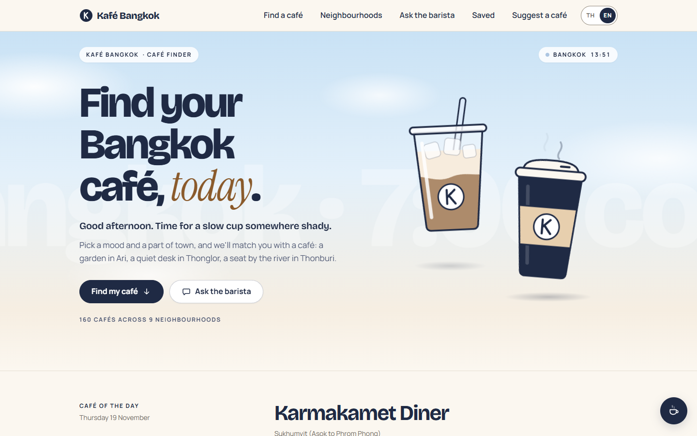
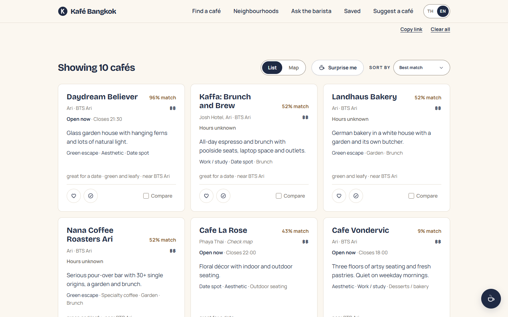
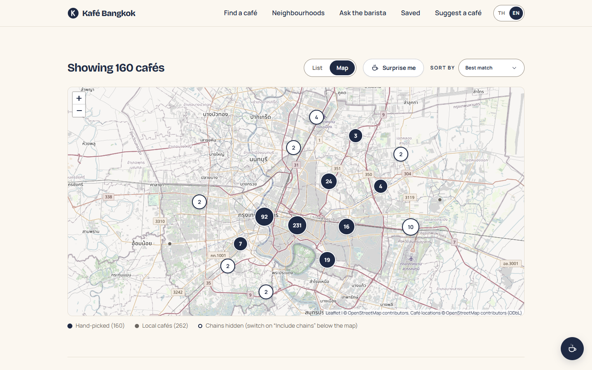
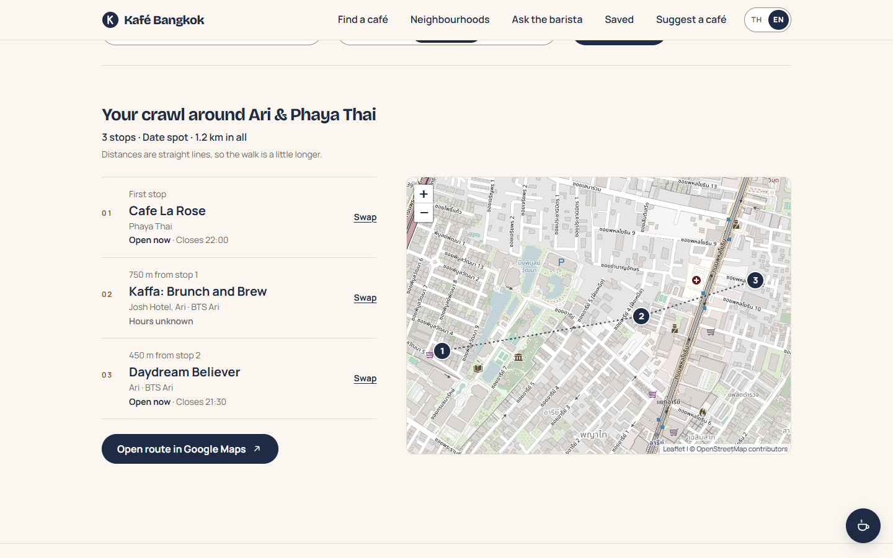
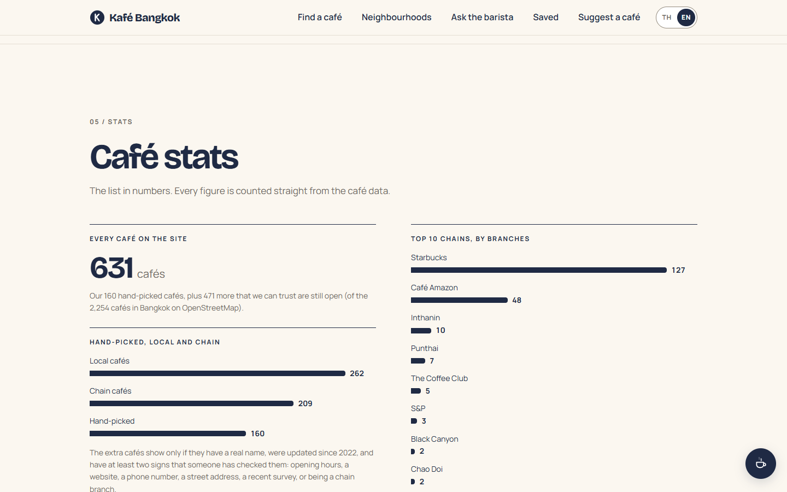

# Kafé Bangkok

**Find a Bangkok café that fits your mood**: a date spot, a green escape, a quiet place to work, somewhere pretty, or somewhere cheap.

**Live demo: [kafebangkok.netlify.app](https://kafebangkok.netlify.app)**

Kafé Bangkok is a café finder for Bangkok, in English and Thai. You pick a mood, a few must-haves and a part of town, and it ranks 160 hand-picked cafés with a match score and a short reason for each one. It also has a rule-based chat "barista", a map, a café crawl planner and stats, plus about 470 more cafés from OpenStreetMap.

It's a static site built with plain HTML, CSS and JavaScript: no framework, no build step, no backend and no API keys. I built it as a final-year IT portfolio project.



## Screenshots

| | |
|---|---|
|  |  |
| *Ranked results with a match % and the reasons each café fits* | *Map view: hand-picked cafés plus OpenStreetMap cafés, clustered* |
|  |  |
| *The café crawl planner finds the shortest walk between stops* | *Stats drawn in plain HTML and CSS, counted from the data* |

## Features

- **Mood finder.** 5 moods and 14 must-haves (garden, riverside, good Wi-Fi, open late, books…), with filters for area, BTS/MRT line, price, "near a station" and "open now". Results are ranked by a match score.
- **Ask the barista.** A chat that understands messages like *"quiet cheap place in Ari to study"* or *"no rooftop, not too expensive"*. It asks follow-up questions and suggests the top 3 cafés. It's rule-based, with no AI service.
- **Map view.** Leaflet map with clustered pins for the hand-picked cafés and the extra OpenStreetMap ones.
- **Café crawl planner.** Pick a starting station or neighbourhood, a mood and 2 to 4 stops. It finds cafés close together, puts them in the order with the least walking, draws the route on a map and links to Google Maps directions.
- **Open now.** Live "Open now · Closes 22:00" labels from each café's opening hours and the current time in Bangkok.
- **Thai / English.** Every word of the interface is translated, and the barista understands common Thai words too.
- **Saved cafés and a café passport.** Save favourites, mark cafés you've visited and collect neighbourhood "stamps", all stored in the browser.
- **Compare, Surprise me, Café of the day, shareable filter links.**
- **Suggest a café** form, collected by Netlify Forms, with validation and spam protection.
- **Admin page** to add, edit or delete cafés in the browser and download a new `cafes.json`.
- **Accessible and mobile first.** It works by keyboard, meets WCAG AA contrast, respects "reduce motion" and works from 360px phones up.

## How it works

1. **The data is one JSON file.** `data/cafes.json` holds the 160 hand-picked cafés: moods, features, price, opening hours, nearest station and map position. Every count on the site is worked out from this file, so nothing is hard-coded.
2. **Scoring.** Each mood you pick that a café has is worth 10 points, and each must-have is worth 6. A café near a BTS/MRT station gets a small bonus, and so does one checked by hand. The match % is the points a café earned out of the most it could earn. Each point also adds a short reason, like "great for a date" or "near BTS Ari".
3. **The barista** turns what you type into the same choices as the finder, using word lists ("romantic" means date, "plants" means green escape, "no rooftop" removes rooftop). It then uses the same filters and the same score.
4. **The crawl planner** takes the 20 closest cafés with your mood, tries every short route through them and keeps the one with the least walking. It measures distance in straight lines on the Earth's surface (the haversine formula).
5. **The extra OpenStreetMap cafés** come from a Node script, `tools/fetch-osm.mjs`, that downloads every café in Bangkok from OpenStreetMap. It keeps only the ones that look real and still open: 471 of 2,254. The site loads them only when you need them.

The full details (scoring, data format, OpenStreetMap rules, deploy steps) are in [docs/TECHNICAL.md](docs/TECHNICAL.md).

## Tech used

- **HTML, CSS and JavaScript** (ES modules). No framework, no build step and no npm packages.
- **Leaflet 1.9.4 + Leaflet.markercluster 1.5.3** for maps, loaded from cdnjs (pinned, with integrity hashes) only when a map is opened.
- **Node.js** (built-in `fetch` only) for the OpenStreetMap data script.
- **Netlify** for hosting and Netlify Forms for suggestions.
- `<dialog>` for the drawer, chat and compare table, `localStorage` for saved state, and Google Fonts (Bricolage Grotesque, Manrope, Instrument Serif, Noto Sans Thai).

## Data sources and credits

- **Hand-picked cafés:** compiled and checked by hand in November 2026 from public guides: [That Travel Blog](https://thattravelblog.com/), [TripCanvas](https://thailand.tripcanvas.co/), [Visit Thailand Today](https://visitthailandtoday.com/), [Drip Roast](https://driproast.com/), [The Thaiger](https://thethaiger.com/), [Time Out Bangkok](https://www.timeout.com/bangkok), [The Way to Coffee](https://www.thewaytocoffee.com/), [That Bangkok Life](https://www.thatbangkoklife.com/), [Thailand with Tereza](https://thailandwithtereza.com/) and [Tatler Asia](https://www.tatlerasia.com/), plus cafés' own websites. Descriptions are my own writing, and each café's `sources` field links back to where it came from. There are no copied photos or reviews.
- **Café locations and extra cafés:** © [OpenStreetMap](https://www.openstreetmap.org/copyright) contributors, under the [ODbL](https://opendatacommons.org/licenses/odbl/), and [Wongnai](https://www.wongnai.com/) listings.
- **Map tiles:** © OpenStreetMap contributors.
- **Illustrations:** the coffee cups and the "K" logo are original SVGs drawn for this project.

Cafés in Bangkok open and close often, so check Google Maps before you go.

## Run it locally

The site loads its data with `fetch`, so it needs a local web server. Opening `index.html` directly won't work.

```bash
git clone https://github.com/dilshangulati07-crypto/kafe-bangkok.git
cd kafe-bangkok
python -m http.server 8000
```

Then open http://localhost:8000. Any static server works (for example `npx serve`).

To refresh the OpenStreetMap cafés (Node 18+, nothing to install):

```bash
node tools/fetch-osm.mjs --save-raw data-raw/osm-raw.json
```

## Project structure

```
index.html, 404.html, admin.html   pages
css/                               styles
js/                                app logic: score.js, chat.js, crawl.js, map.js, osm.js, i18n.js, ui.js…
data/                              cafes.json (hand-picked) and osm-cafes.json (OpenStreetMap)
tools/fetch-osm.mjs                downloads and cleans the OpenStreetMap cafés
docs/                              technical notes and screenshots
```

---

Built by **Dilshan Gulati** · [Portfolio](https://dilshanportfolio1.netlify.app)
